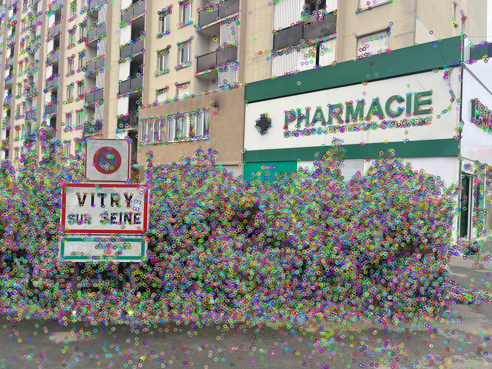
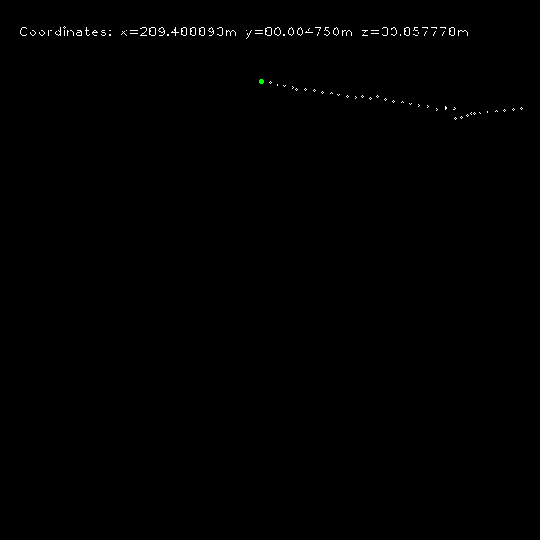

# Monocular Visual Odometry and Camera Calibration

A computer vision project exploring camera calibration and monocular visual odometry using self-recorded image sequences. The project compares feature detectors and examines how lighting, frame sampling, camera motion, and visual target patterns affect the estimated trajectory.

The accompanying [project report](report.pdf), *Visual Odometry in Monocular Vision: Study and Analysis*, lists **Xiaowei Chen and Bo Wang** as its authors.

## Project Overview

The implementation combines:

- **Camera calibration:** chessboard corner detection, subpixel refinement, and estimation of camera intrinsics and distortion coefficients.
- **Feature detection:** FAST by default, with SIFT and ORB alternatives explored in the report.
- **Feature tracking:** pyramidal Lucas–Kanade optical flow between consecutive grayscale images.
- **Motion estimation:** essential-matrix estimation with RANSAC, followed by recovery of relative rotation and translation.
- **Trajectory visualization:** accumulation of relative poses and plotting of the estimated motion in the X–Z plane.
- **Experimental analysis:** qualitative comparisons across scenes, lighting conditions, sampling intervals, translation, rotation, and printed character patterns.

The character-pattern experiment compares visual odometry on different printed targets, including a Chinese character and the letter **X**. Its purpose is to study the influence of image features on motion estimation; OCR and language classification are outside the implemented scope.

## Example Outputs

Detected FAST keypoints in the pharmacy sequence:



An archived trajectory estimate:



White points represent the estimated trajectory. The green point is the fixed reference origin. Coordinates have **arbitrary scale**: although the original display appends `m`, the implementation uses a fixed translation multiplier rather than a measured metric scale.

## Repository Structure

| File or directory | Purpose |
| --- | --- |
| `calibration.py` | Calibrate the camera from chessboard photographs. |
| `visual_odometry.py` | Camera model, feature detection and tracking, relative-pose estimation, and pose accumulation. |
| `test.py` | Main demonstration script: read numbered photographs and draw the trajectory. |
| `photocalibration/` | Fourteen chessboard photographs used for calibration. |
| `pic/` | Active image sequence used by the default demonstration. |
| `pharmacie/`, `magasin/` | Outdoor scenes used to compare feature detection and estimated trajectories. |
| `allume/`, `eteint/` | Image sequences recorded under different lighting conditions. |
| `signalisation_rotation/` | Road-sign sequence with rotational camera motion. |
| `singalisation_translation/` | Road-sign sequence with translational camera motion. The folder spelling is preserved from the original archive. |
| `ecriture2/` | Printed-character target sequence used in the report. |
| `results/` | Saved feature-detection visualization. |
| `map.png` | Saved trajectory plot. |
| `report.pdf` | Four-page report describing the methods, experiments, and observations. |
| `videos_example.mp4` | Supporting demonstration video. |
| `发给组员.mp4` | Additional video included in the original project archive. |
| `Readme_important.txt` | Original French notes about manually configuring the experiments. |

The report sometimes refers to the demonstration entry point as `main.py`. In this archive, that script is named **`test.py`**.

## Setup

The original scripts use Windows-style relative paths and OpenCV display windows. Run the commands below in **Windows PowerShell**, from the directory containing `calibration.py` and `test.py`.

Install Python 3.12 with `pip` available, and use a desktop session for the interactive image windows.

This dependency combination was checked with **Python 3.12.15**:

```powershell
python -m venv .venv
.\.venv\Scripts\python.exe -m pip install "numpy==1.26.4" "opencv-python==4.11.0.86"
```

The version pins preserve compatibility with the archived plotting code. A check with NumPy 2.5.4 and OpenCV 5.0.0 failed when `test.py` converted a one-element array to a Python scalar. NumPy 1.26.4 completes the demonstration, while emitting deprecation warnings for those conversions.

Linux and macOS users need to adapt the backslash-based image paths in the two entry scripts before running them.

## Running the Project

### 1. Camera calibration

```powershell
.\.venv\Scripts\python.exe calibration.py
```

The script reads `photocalibration/*.JPG`, resizes each photograph from **4032 × 3024** to **1008 × 756**, and detects a chessboard with **9 × 6 inner corners**. The object-point spacing is set to **20 mm**.

It prints:

- `mtx`: the camera intrinsic matrix;
- `dist`: the estimated distortion coefficients.

These values are printed to the terminal; the script does not automatically save them or transfer them to `test.py`.

**Keep calibration and processing resolution consistent.** Calibration already runs on quarter-size images. The report lists approximate intrinsics `fx=816`, `fy=818`, `cx=506`, and `cy=344` for that resized resolution. The archived `test.py` multiplies those values by `0.25` again and retains the original image dimensions in `PinholeCamera`. Align the camera dimensions and intrinsics with the processed image size before evaluating pose accuracy. Distortion coefficients are also calculated separately from the current VO input pipeline, which performs no undistortion step.

### 2. Default visual odometry demonstration

Keep the supplied `results/` directory in place, then run:

```powershell
.\.venv\Scripts\python.exe test.py
```

The default configuration:

- loads images from `pic/`;
- processes **39 frames**, `IMG_4035.JPG` through `IMG_4073.JPG`, using `range(4035, 4074)`;
- detects FAST keypoints and tracks them with Lucas–Kanade optical flow;
- estimates and accumulates relative motion;
- displays the source image and the estimated trajectory.

The first keypoint window pauses at `cv2.waitKey(0)`. Focus that window and **press a key** to continue.

The script writes `results/lol0.png` and `map.png`, replacing the existing files with the latest run. The `pic/` directory contains one additional image, `IMG_4074.JPG`, which is outside the default loop's exclusive upper bound.

### 3. Switch image sequences

Dataset selection is configured directly in `test.py`. Update all three of the following together:

1. The folder in `cv2.imread(...)`.
2. The start, stop, and optional step in `range(...)`.
3. The first-frame comparison, currently `if(img_id > 4035)`, so that it matches the new starting ID.

| Sequence | Available image IDs | Images |
| --- | --- | ---: |
| `pic/` | 4035–4074 | 40 |
| `pharmacie/` | 4035–4074 | 40 |
| `magasin/` | 4137–4176 | 40 |
| `allume/` | 4221–4242 | 22 |
| `eteint/` | 4243–4261 | 19 |
| `signalisation_rotation/` | 4112–4136 | 25 |
| `singalisation_translation/` | 4081–4105 | 25 |
| `ecriture2/` | 4264–4280 | 17 |

For example, processing every image in `magasin/` requires the folder `magasin`, `range(4137, 4177)`, and a first-frame comparison against `4137`. A larger range step skips photographs and reproduces the report's frame-sampling experiment.

### 4. Compare feature detectors

Select one detector in `VisualOdometry.__init__` in `visual_odometry.py`:

```python
self.detector = cv2.FastFeatureDetector_create(threshold=25, nonmaxSuppression=True)
# self.detector = cv2.SIFT_create()
# self.detector = cv2.ORB_create(500, nlevels=15)
```

Enable one line at a time. These alternatives change keypoint detection; tracking continues to use Lucas–Kanade optical flow. The report also discusses a `goodFeaturesToTrack` experiment, for which the source retains commented code requiring manual adaptation.

## Experiments and Interpretation

The report compares FAST, SIFT, and ORB on the same scene, then uses FAST for further experiments involving lighting changes, skipped frames, translation versus rotation, and printed visual targets. Its observations concern feature detection and trajectory shape on the recorded sequences.

The current implementation has several important interpretation limits:

- Translation uses a fixed `scale = 10.0`; trajectory values remain relative and scale-ambiguous.
- The green reference point remains at the origin; the script does not load a measured ground-truth trajectory.
- Camera calibration parameters require the consistency checks described above.
- Missing images, insufficient tracked points, and unsuccessful pose estimation have limited error handling.

These experiments provide a qualitative study of visual odometry. The report supplies no ground-truth trajectory error benchmark.

## Reproduction Check

A non-interactive check on Windows with Python 3.12.15, NumPy 1.26.4, and OpenCV 4.11.0.86 completed:

- chessboard detection on **14 of 14** calibration images at 1008 × 756 resolution;
- camera calibration with an RMS reprojection error of approximately **0.549 pixels**;
- the default **39-frame** FAST visual odometry sequence, including generation of the trajectory and keypoint images.

For this check, display calls were disabled and generated images were redirected to a separate directory. The project source and existing outputs were preserved. This verifies execution of the archived workflow; the calibration RMS value describes image reprojection, while VO trajectory accuracy remains unbenchmarked.

## Acknowledgements and References

- **Coursework authors:** Xiaowei Chen and Bo Wang, as credited in [the report](report.pdf).
- **Reference implementation:** [uoip/monoVO-python](https://github.com/uoip/monoVO-python), identified in the original report as the basis adapted for this project.
- **Calibration reference:** [OpenCV camera calibration documentation](https://docs.opencv.org/4.x/dc/dbb/tutorial_py_calibration.html).
